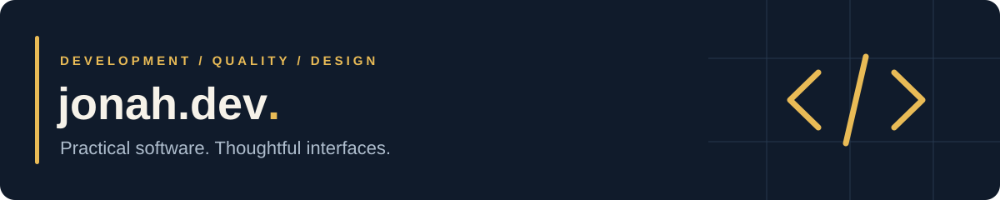
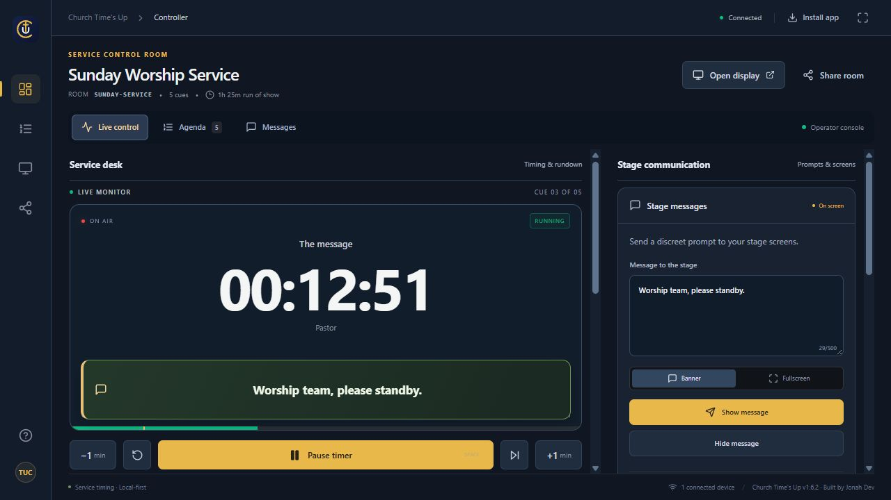

# Jonah Mark Tabuzo

**Full-stack developer · Quality assurance · Visual creator**

I build web and desktop applications that make everyday work easier, from inventory and school systems to tools for church services. Based in the Philippines, I combine software development, quality assurance, and a focus on clear, usable interfaces.

[Portfolio & case studies](https://tabuzoportfolio.vercel.app/) · [LinkedIn](https://www.linkedin.com/in/jonah-mark-tabuzo-676389191/) · [Email](mailto:jonahmarkt@gmail.com)

## Featured work

### Church Time’s Up

An offline Windows app for service timing and presenter communication. Operators can manage the rundown, send stage messages, choose a stage monitor, and place a timer over presentation slides. Local Wi-Fi viewers and OBS browser output support the wider production setup.

**React · TypeScript · Electron · Node.js · Socket.IO**

[View the project in my portfolio](https://tabuzoportfolio.vercel.app/#projects) — source code is private.

See the controller

### More projects

| Project | What it does | Explore |
| :--- | :--- | :--- |
| **KiddyTrack** | Academic monitoring, attendance, lesson approval, and teacher–parent communication with separate user roles. | [Repository](https://github.com/N3RO-O/kiddytrack-CPIC) |
| **Nerovault** | A local-first budgeting and savings PWA with offline support and backup/export tools. | [Repository](https://github.com/N3RO-O/Nerovault) |
| **PHILRADS systems** | Inventory and asset management tools with tracking, approval workflows, and activity logs. | [Portfolio case studies](https://tabuzoportfolio.vercel.app/#projects) |
| **Jonah Dev** | My responsive portfolio, with project walkthroughs, screenshots, and development experience. | [Live portfolio](https://tabuzoportfolio.vercel.app/) · [Repository](https://github.com/N3RO-O/jonahdev) |

## My toolkit

| Area | Technologies & focus |
| :--- | :--- |
| **Interfaces** | React, TypeScript, JavaScript, HTML, CSS, Tailwind CSS |
| **Applications & data** | PHP, MySQL, Node.js, Express, Electron, Socket.IO |
| **Quality & delivery** | Functional testing, usability review, responsive interfaces, Git, GitHub |

## Background

- **PIXODE Philippines:** freelance Quality Assurance Engineer experience, focused on functionality, usability, and clear feedback for developers.
- **PHILRADS:** IT support and full-stack development of inventory and asset management systems during my internship.
- **Catanduanes State University:** BS Information Systems graduate; lead programmer for an academic monitoring capstone project.

## Let’s connect

Interested in web development, quality assurance, and practical tools for organizations and communities. For project inquiries or collaboration, reach me at **[jonahmarkt@gmail.com](mailto:jonahmarkt@gmail.com)**.
